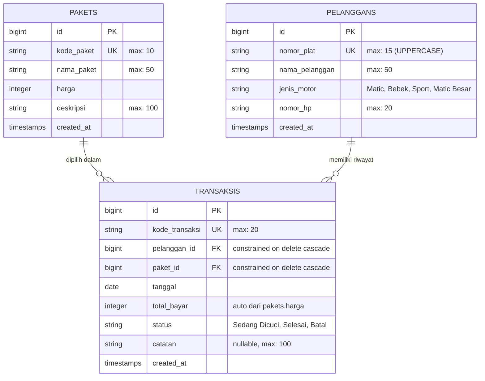

# 🏍️ GARASI CUCI MOTOR — STEAM & CARE PRO
### *Sistem Kasir & Manajemen Antrean Cuci Motor Berbasis Web*

[](https://laravel.com)
[](https://php.net)
[](https://getbootstrap.com)
[](https://mysql.com)
[](https://vitejs.dev)
[-10b981?style=for-the-badge&logo=checkmarx&logoColor=white)](tests)
[](LICENSE)

---

## 📌 Tentang Proyek
**GARASI CUCI MOTOR** adalah aplikasi kasir dan manajemen operasional antrean motor masuk yang dirancang khusus untuk memenuhi kebutuhan bisnis UMKM jasa pencucian motor (*snow wash & steam care*). 

Dibangun dengan arsitektur **Laravel** dan balutan **UI Dark Otomotif Modern**, sistem ini mempermudah kasir dan pengelola dalam mencatat kendaraan masuk, melacak status pengerjaan di pit cuci secara *real-time*, menghitung pendapatan bersih, menerbitkan struk kasir thermal, hingga mengirimkan notifikasi otomatis ke nomor WhatsApp pelanggan ketika pencucian selesai.

Aplikasi ini dikembangkan sebagai **Tugas Akhir / Final Project Mata Kuliah Pemrograman Web II**.

---

## 🚀 Fitur Unggulan

| Fitur | Deskripsi |
| :--- | :--- |
| 🏎️ **Tema Dark Otomotif Premium** | Antarmuka gelap elegan (`#0b0f19` / `#1e293b`), tipografi modern *Plus Jakarta Sans*, Bootstrap Icons v1.11.3, dan navbar mobile responsif. |
| 📊 **Dashboard Real-Time** | Menampilkan 4 KPI utama dengan kartu gradasi: Total Pendapatan Selesai (Emerald), Motor Sedang Dicuci (Amber), Unit Masuk Hari Ini (Blue), dan Total Pelanggan (Slate). |
| ⚡ **Aksi Cepat Antrean** | Tabel antrean pit aktif dilengkapi tombol satu-klik **"Selesai Cuci &rarr;"** yang langsung memperbarui status kendaraan. |
| 💰 **Auto-Kalkulasi Tarif** | Total pembayaran transaksi dihitung otomatis dari harga paket cuci di database, mencegah kesalahan input manual oleh kasir. |
| 🔤 **Format Otomatis Plat Nomor** | Sistem otomatis mengonversi input nomor plat motor menjadi huruf kapital (*UPPERCASE*) dengan tampilan badge plat nomor hitam khas otomotif. |
| 🧾 **Struk Kasir Thermal (340px)** | Modul cetak struk nota belanja bergaya printer kasir POS thermal (58mm/80mm) ber-font monospace lengkap dengan nomor nota, rincian biaya, dan status lunas. |
| 💬 **Integrasi Notifikasi WhatsApp** | Tombol WhatsApp pintar muncul otomatis pada transaksi berstatus **Selesai**, langsung mengarah ke `wa.me` dengan teks pesan konfirmasi siap kirim ke pelanggan. |
| 📑 **3 Laporan Siap Cetak (A4 / PDF)** | <ul><li>**Laporan Paket Cuci**: Daftar tarif dan deskripsi layanan.</li><li>**Laporan Data Pelanggan**: Rekap data pemilik dan jenis motor.</li><li>**Laporan Keuangan Transaksi**: Rekapitulasi omzet dengan filter rentang tanggal (*tgl_awal* & *tgl_akhir*).</li></ul> |
| 🛡️ **Autentikasi & Profil Kasir** | Proteksi route middleware `auth`, ganti nama, email unik, dan pembaruan password dengan enkripsi `Hash::make()`. |
| 🧪 **Comprehensive Automated Tests** | Dilengkapi 8 automated feature test (100% lulus) yang menguji alur autentikasi, dashboard, validasi model, kalkulasi tarif, dan cetak dokumen. |

---

## 🗄️ Skema Basis Data & Relasi (ERD)

Sistem menggunakan 3 tabel utama yang saling berelasi dengan integritas data *Cascading Delete*:



---

## 🔐 Kredensial Akun Bawaan (Default Login)

Halaman login telah terkonfigurasi dengan nilai bawaan otomatis untuk kemudahan demonstrasi saat presentasi:

| Keterangan | Detail Kredensial |
| :--- | :--- |
| **URL Login** | `http://127.0.0.1:8000/login` |
| **Role / Hak Akses** | Administrator / Kasir Utama |
| **Email** | `admin@gmail.com` |
| **Password** | `12345678` |

---

## ⚙️ Panduan Instalasi Lokal (Quick Start)

Ikuti langkah-langkah berikut untuk menjalankan proyek di komputer lokal:

### 1. Prasyarat Sistem
- **PHP** >= 8.2 (Disarankan PHP 8.3)
- **Composer** >= 2.x
- **MySQL / MariaDB** (Disarankan via Laragon atau XAMPP)
- **Node.js** >= 18.x & **NPM**

### 2. Kloning Repositori
```bash
git clone https://github.com/DilanAhoy/garasi-cuci-motor.git
cd garasi-cuci-motor
```

### 3. Pasang Dependensi Backend & Frontend
```bash
composer install
npm install
npm run build
```

### 4. Konfigurasi Lingkungan (`.env`)
Salin file konfigurasi `.env.example` ke `.env`:
```bash
cp .env.example .env
php artisan key:generate
```

Sesuaikan parameter database di dalam file `.env`:
```env
DB_CONNECTION=mysql
DB_HOST=127.0.0.1
DB_PORT=3306
DB_DATABASE=db_cucimotor
DB_USERNAME=root
DB_PASSWORD=
```

### 5. Jalankan Migrasi & Data Seeder
Pastikan service MySQL telah berjalan, kemudian jalankan migrasi fresh beserta data bawaan (Admin, 4 Paket Cuci, 2 Pelanggan, dan 1 Transaksi):
```bash
php artisan migrate:fresh --seed
```

### 6. Jalankan Server Aplikasi
```bash
php artisan serve
```
Buka browser dan akses aplikasi melalui: **[http://localhost:8000](http://localhost:8000)**.

---

## 🧪 Menjalankan Pengujian Otomatis (Automated Tests)

Seluruh logika bisnis dan rute aplikasi telah diuji dengan PHPUnit/Pest Feature Tests:

```bash
php artisan test
```

### Hasil Pengujian:
```text
   PASS  Tests\Unit\ExampleTest
  ✓ that true is true

   PASS  Tests\Feature\ExampleTest
  ✓ the application returns a successful response

   PASS  Tests\Feature\GarasiCuciMotorTest
  ✓ halaman login dapat diakses dan user dapat login
  ✓ dashboard home menampilkan data statistik dengan status 200
  ✓ modul paket dapat membuat paket baru dan terdaftar di database
  ✓ modul pelanggan dapat menyimpan data dan plat otomatis uppercase
  ✓ modul transaksi otomatis menghitung total bayar sesuai harga paket
  ✓ halaman cetak nota dan laporan keuangan dapat diakses dengan status 200

  Tests:    8 passed (32 assertions)
  Duration: 1.18s
```

---

## 📂 Struktur Direktori Utama

```text
garasi-cuci-motor/
├── app/
│   ├── Http/Controllers/
│   │   ├── HomeController.php          # Logika KPI dashboard & antrean aktif
│   │   ├── PaketController.php         # CRUD paket cuci & laporan
│   │   ├── PelangganController.php     # CRUD pelanggan, plat uppercase & laporan
│   │   ├── ProfileController.php       # Manajemen akun kasir
│   │   └── TransaksiController.php     # Transaksi cuci, nota thermal & rekap omzet
│   └── Models/
│       ├── Paket.php                   # Model paket cuci
│       ├── Pelanggan.php               # Model data pelanggan & motor
│       ├── Transaksi.php               # Model transaksi & relasi
│       └── User.php                    # Model kasir/pengguna
├── database/
│   ├── migrations/                     # Skema tabel pakets, pelanggans, transaksis
│   └── seeders/DatabaseSeeder.php      # Data dummy awal akun, paket, dan transaksi
├── resources/
│   └── views/
│       ├── auth/login.blade.php        # Halaman login cockpit dark otomotif
│       ├── layouts/app.blade.php       # Layout utama, navbar & mobile responsive
│       ├── home.blade.php              # Dashboard operasional garasi
│       ├── paket_*.blade.php           # Tampilan index, create, edit, laporan paket
│       ├── pelanggan_*.blade.php       # Tampilan index, create, edit, laporan pelanggan
│       ├── transaksi_*.blade.php       # Tampilan antrean, form, laporan & struk nota
│       └── profile.blade.php           # Pengaturan profil pengguna
├── routes/web.php                      # Routing aplikasi & middleware auth
└── tests/Feature/
    └── GarasiCuciMotorTest.php         # Automated feature test cases
```

---

## 👨‍💻 Pengembang
- **Nama Pengembang:** Dilan Ahoy
- **Institusi:** STIKOM Dinamika Bangsa / Universitas Dinamika Bangsa Jambi
- **Program Studi:** Sistem Informasi / Teknik Informatika
- **Mata Kuliah:** Pemrograman Web II (Semester 7)

---
*© 2026 Garasi Cuci Motor Steam Pro. All Rights Reserved.*
